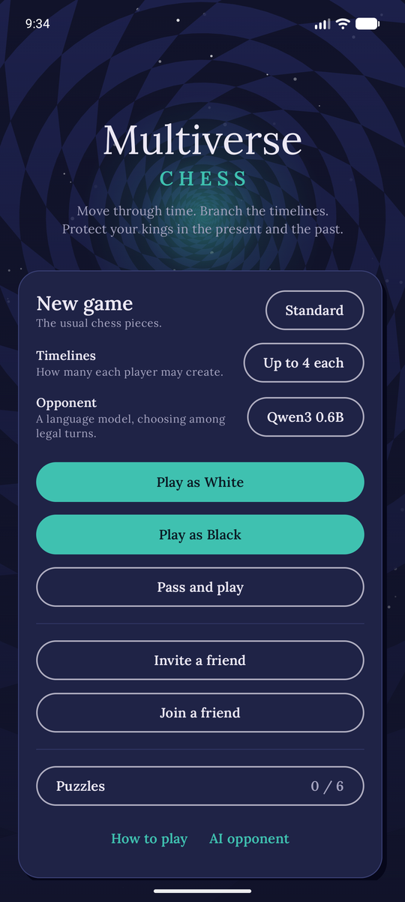
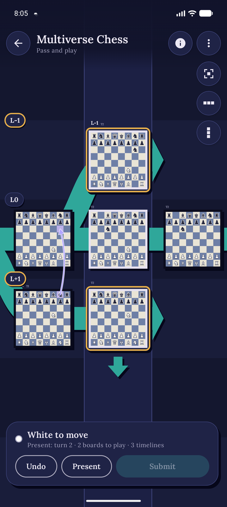
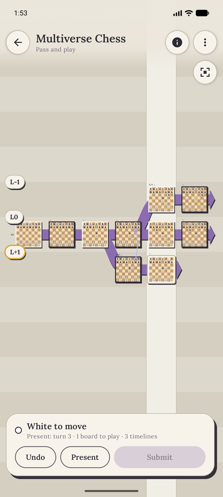
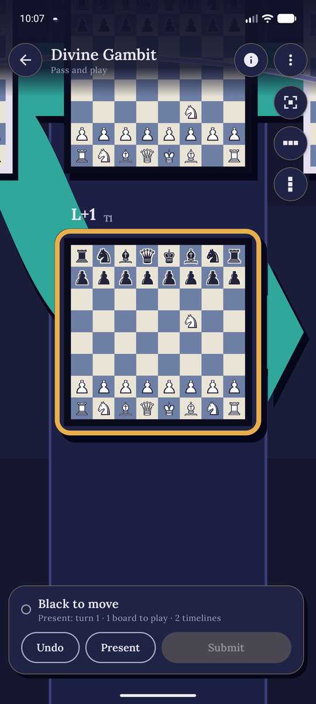
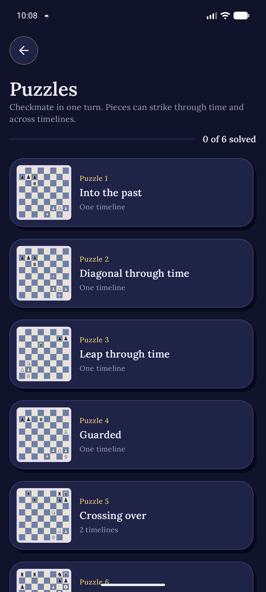
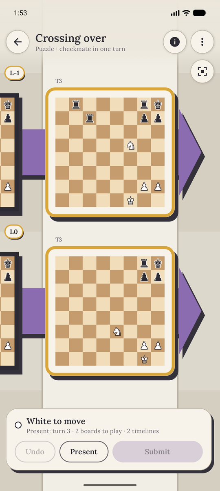
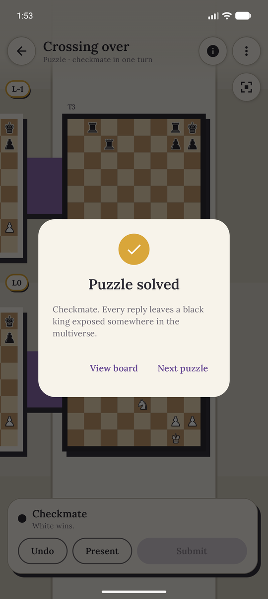

# Multiverse Chess (Android)

Chess with time travel and parallel timelines, for Android. Send a knight two turns into the past
and the timeline splits; play both futures at once; protect your kings in the present *and* the
past.

**[Download the latest APK](https://github.com/Andreas-Erick/5D-Chess/releases/latest)** (Android 7.0
or newer; allow installing from your browser or file manager when asked).

Inspired by *5D Chess With Multiverse Time Travel*. This is an independent fan project. It is not
affiliated with or endorsed by the original game's developers, and it uses none of the original
game's code or assets.

<p align="center">
  
  
  
</p>

## Features

* **The whole multiverse on one canvas.** Every board of every timeline, laid out like a board
  game on a table: purple ribbons carry each timeline forward, a pale column marks the present, and
  the boards you can play sit on raised cards.
* **Built for finding your way.** Pinch, drag and fling around freely; tap a timeline to frame it,
  tap a distant board to zoom in on it, or jump to the whole multiverse or back to the present with
  one button. Chips on the screen's edge name the timelines that are out of view, and turn gold
  when you still have to move there.
* **Full four-dimensional movement** for every piece, including castling, en passant, double steps
  across timelines and promotion, plus four fairy-piece variants.
* **Play against the computer** as either side, or **pass and play** on one device. Undo is
  unlimited.
* **Six puzzles** that teach the core ideas, each checked by an exhaustive solver, and **new puzzles
  generated on your phone** once you've solved them all.
* **Your game is saved** as you play, and **Continue game** picks it up after the app is closed.

## How to play

<p align="center">
  
  
  
</p>

* Each **row is a timeline**. L0 is the original; White's new timelines are numbered +1, +2… and
  drawn below, Black's −1, −2… above. Each **column is a half-move**, advancing to the right.
* Tap one of your pieces on a raised board, then tap a green destination. Destinations can be on
  other boards: in the past, or on other timelines.
* Pieces move through four dimensions: file, rank, **time** (one step = one full turn) and
  **timeline**.
  * Rook: any distance along exactly one dimension.
  * Bishop: the same distance along exactly two dimensions.
  * Queen: the same distance along any number of dimensions. King: one step that way.
  * Knight: two along one dimension and one along another.
  * Pawn: one rank forward, or one timeline toward the opponent (up the screen for White, down for
    Black); an unmoved pawn may take a double step either way; captures diagonally on the board or
    one timeline forward plus one turn back or ahead; en passant and promotion (to a queen) on the
    board.
  * Sliding pieces can't pass through boards that don't exist.
* Moving to the **latest board of another timeline** continues that timeline, so one move plays
  two boards. Moving to an **earlier board** creates a new timeline branching from it.
* **Timeline limit:** unless you choose Unlimited when starting a game, each player may create up
  to 4 timelines (or 8). After that they can't branch any more, so moves into the past, including
  attacks on a king's past, are no longer possible for them. The limit keeps the multiverse small
  enough for the game to reliably tell whether a position is checkmate.
* A player may have at most **one more active timeline** than the opponent. Extra timelines are
  dimmed: they can still be played, but they don't hold back the present. A **purple arrow** at
  the end of the present means your next new timeline would be active.
* **The present** is the earliest end of any active timeline. On your turn you must move on every
  board in the present (gold ring), may move on your other raised boards, then tap **Submit**.
  Branching a new active timeline into the past pulls the present back with it, which can end your
  obligation to play the other present boards.
* You can't submit a turn that lets the opponent capture any of your royal pieces (kings, or royal
  queens in that variant), including those on past boards (red arrows show the threats, and a red
  **!** marks each timeline whose advancement would let a king be captured). If no sequence of moves can shift the present without leaving a
  king attacked, it's checkmate when a king is threatened and stalemate otherwise. After the game,
  you can still try the loser's moves to see why every turn fails.
* While a piece is selected, the boards it can't land on (the opponent's, half a turn out of step)
  are faded.

### Finding your way around

| Gesture | What it does |
| --- | --- |
| Drag, fling, pinch | Pan and zoom anywhere. |
| Tap a timeline's ribbon or the space around its boards | Frame that timeline. |
| Tap a timeline chip on the left edge | Frame that timeline (gold: you still have to move there). |
| Tap a board that's too small to play on | Zoom in on it. |
| Corners button (top right) | Show the whole multiverse. |
| **Present** | Back to the boards you have to play. |
| Row-of-boards button | **History view**: only the selected piece's timeline, through time, with your opponent's boards hidden and the gaps they leave closed up, so each column is one full turn. |
| Column-of-boards button | **Parallel view**: only the selected piece's moment, across every timeline. |

Without a piece selected, the History and Parallel views use the first board you have to play.

## Variants

Pick a variant in the menu before starting a game. Fairy pieces are drawn as discs with their
5D chess notation letter.

| Variant | Setup |
| --- | --- |
| Standard | The usual pieces. |
| Princesses | Queens become princesses (**S**): any distance along one or two dimensions. |
| Unicorns | Bishops become unicorns (**U**): equal distance along exactly three dimensions. |
| Brawns | Pawns become brawns (**W**): pawns that can capture one step along any diagonal that includes a forward step (rank or timeline) and no backward one. |
| Royal Queens | The queen becomes a royal queen (**Y**): it moves like a queen but is royal, so it must be protected like a king. The king becomes a common king (**C**): it moves like a king but may be attacked or captured. |
| Menagerie | Unicorn, princess, dragon (**D**, equal distance along all four dimensions) and brawns. |

Unicorns and dragons can never move on their own board, so they wake up once there is history to
travel through.

## Puzzles

<p align="center">
  
</p>

**Puzzles** in the menu opens six "White to checkmate in one turn" puzzles that teach the core
ideas: attacking a king's past, which it can't step away from, with a rook, bishop and knight;
protecting the attacker; one move that plays two timelines; and a unicorn. The positions are
original, and built by replaying a short history so every board in them is consistent. Each has a
hint, a restart button and a reveal-solution option; a wrong answer is taken back with an example
of how Black escapes, and solved puzzles are remembered on the device.

Once all six are solved, **Generate a puzzle** makes new ones on the phone, usually within a few
seconds. It builds a sparse position, plays a few random turns of history (sometimes sending a
piece back in time), and keeps the first position where White has a mate with only one or two
solutions, preferring mates through time or across timelines. `PuzzleGenerator` lives in the
engine, and generated puzzles are kept on the device.

The puzzles are defined in `engine/.../Puzzles.kt`. `PuzzlesTest` checks that each stated solution
is mate and that the exhaustive `PuzzleSolver` finds at most two mating turns, so new puzzles can
be added safely.

## How the rules are checked

A turn in this game can be several moves on several boards, and the order matters: a piece sent to
another present board continues that timeline if the board hasn't been played yet, but branches a
new timeline from it if it has. Checkmate, the computer player and the puzzle checker all share one
turn search (`TurnWalker` in `engine/.../TurnSearch.kt`) that tries the present boards in every
order, allows extra moves on other boards at any point, and explores each position reached by
different orders only once. It also abandons any partial turn that already leaves a royal piece
capturable: within a turn, moves can only add threats, never remove them, because a threat comes
from a board the opponent can play (which this turn can't touch) against a board that already
exists (which can't change), and new boards only ever extend a line of attack.

To decide whether a player has any legal turn at all, the search skips moves on other boards that
can't help (one that neither branches nor leaves behind a board another move lands on), and in a
second, thorough pass carries the moves found losing down the search instead of re-checking them.
When the player can't branch (at the timeline limit), move order no longer matters, and a
constraint solver finds a move for each present board, most constrained board first. The check
after each turn gets up to three seconds.

The computer looks two turns ahead: it scores its candidate turns, then checks the opponent's
replies to the most promising ones, takes any checkmate it finds, and avoids turns that allow one.
It thinks for about two seconds at most.

The engine's tests (`./gradlew :engine:test`) cover movement in all four dimensions, branching and
jumping, active and inactive timelines, the present moving back, checks through time against kings
in the past, escapes that only exist when the boards are played in a particular order, castling,
en passant, promotion, the fairy pieces, every puzzle, the session and undo logic, and the computer
player.

## Building

1. Open the repository root in **Android Studio** (Ladybug or newer) and let Gradle sync.
   It uses AGP 9.2, Kotlin 2.4 and Jetpack Compose, with Gradle 9.4.1 through the wrapper
   (which runs on the Java 25 runtime bundled with current Android Studio).
2. Run the `app` configuration on a device or emulator (Android 7.0 / API 24 or newer).

Release builds (`./gradlew :app:assembleRelease`) are minified, and signed if a
`keystore.properties` file in the repository root names a keystore (`storeFile`, `storePassword`,
`keyAlias`, `keyPassword`). That file and the keystore are kept out of git.

The rules live in the `engine` module, plain Kotlin with no Android dependencies, so they can be
tested quickly on the JVM:

```
./gradlew :engine:test
```

| Path | What it contains |
| --- | --- |
| `engine/` | Game rules: multiverse state, move generation, turn search, check and checkmate, computer player, variants, puzzles, session and undo logic. Unit-tested. |
| `app/` | Android app: Compose UI that draws the multiverse, handles navigation and taps, and runs the computer on a background thread. |
| `docs/screenshots/` | The screenshots in this README. |

The UI uses the Lora typeface (SIL Open Font License, see
`app/src/main/assets/licenses/Lora-OFL.txt`).

## Known simplifications

* After each turn, a search of up to three seconds checks whether the next player has a legal turn,
  allowing at most one extra move on a non-present board (two when checking puzzles). With the
  default timeline limit it decided every position in our test games; with more timelines it can
  occasionally run out first. The game then continues, and **⋮ › No legal turn?** searches every
  turn, as long as it takes, to end the game or show a legal first move. A computer that can't
  find a turn resigns rather than being declared mated.
* Castling only checks whether the king's squares are attacked on its own board, not by pieces
  elsewhere in the multiverse.
* Pawns always promote to a queen.
* The computer looks only two turns ahead and judges positions mostly by material, so it's a
  sparring partner rather than a strong player.
* Pieces are drawn with the Unicode chess symbols from the system font.
